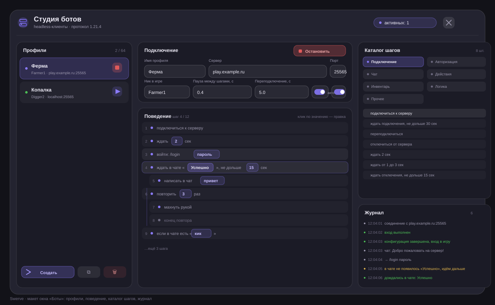

# Боты — студия headless-клиентов

Окно **«Боты»** создаёт профили ботов: бот — это отдельное TCP-соединение с сервером
Minecraft 1.21.4, которое живёт в фоновом потоке клиента. Игровой мир для него не нужен:
бот входит на сервер, держит соединение (keep-alive), читает чат и выполняет собранное
пользователем поведение. Окно можно закрыть — бот продолжит работать.



*Макет раскладки: панели, порядок элементов и акценты совпадают с игровым окном;
шрифт в игре — фирменный MSDF-шрифт клиента.*

## Как открыть

ClickGUI (`Right Shift`) → нижний док, пятая кнопка **Боты** (иконка сервера).
Окно открывается поверх меню, `Esc` или крестик возвращают обратно в меню.

## Окно

```
┌──────────────────────────────────────────────────────────────────────────────┐
│ ◉ Студия ботов                                  ● работают: 1            ✕   │
│   headless-клиенты · протокол 1.21.4 · 3 профилей                            │
├──────────────────────────────────────────────┬───────────────────────────────┤
│ Подключение                      в игре · 12.4 64.0 -8.2 · ♥ 20  [Остановить]│
│ Имя профиля   Сервер               Порт      │ Каталог шагов         64 шага │
│ [ Ферма     ] [ play.example.ru  ] [ 25565 ] │ [🔍 Поиск шага…            ]  │
│ Ник     Пароль    Пауза   Переподкл.  Авто…  │ [Подкл.][Автор.][Чат][Действ.]│
│ [Farmer1][пароль][0.4   ][5.0      ][вкл ]  │ [Инвент.][Логика][Прочее]     │
├──────────────────────────────────────────────┤ · подключиться к серверу      │
│ Поведение                     шаг 4 / 12 👁  │ · ждать подключения 30 сек    │
│ [+ Авторизация][+ Регистрация][+ Ферма]…     │ · переподключиться            │
│ ┌──────────────────────────────────────────┐ ├───────────────────────────────┤
│ │  1 ● подключиться к серверу              │ │ Журнал              6 записей │
│ │  2 ● ждать [2] сек                       │ │ [Чат][Команды][Полный вывод] │
│ │  3 ● войти: /login [пароль]              │ │ 12:04:03 Добро пожаловать…   │
│ │  4 ● ждать в чате «[Успешно]»  [15] сек  │ │ 12:04:04 → /login пароль     │
│ │     5 ● написать в чат [привет]          │ │ 12:04:05 вход выполнен       │
│ │  6 ● повторить [3] раз                   │ │                              │
│ │     7 ● махнуть рукой                    │ │                              │
│ │     8 ● конец повтора                    │ │                              │
│ └──────────────────────────────────────────┘ │                              │
└──────────────────────────────────────────────┴───────────────────────────────┘
```

Шрифт окна специально крупный: 15–22 px в реальных пикселях окна, то есть примерно
как обычный текст Minecraft при guiScale 2 — читается без прищуривания.

### Панель профилей — выдвижная

Панели профилей на экране нет: она спрятана за левым краем, и у края видна только
тонкая «ручка» с иконкой. Подведите курсор к левому краю окна — панель выезжает
пружиной, слегка проскакивает и возвращается (bounce). Уведите курсор вправо, и она
уедет обратно; клик по ручке закрепляет панель открытой.

Внутри: список профилей (имя, ник и адрес, число шагов, точка состояния — серая не
запущен, зелёная работает), кнопка ▶/■ у каждого, «запустить всех»/«остановить всех»,
а внизу — создать, копировать, удалить.

### Поведение — крупные плашки

Шаги выглядят как плашки, соединённые язычками, как в Wild:

* **перетаскивание мышью** — схватите плашку и тащите; в месте вставки появляется
  акцентная линия. Бросили мимо рабочей области — плашка вернётся на место;
* **вложенность** — плашки внутри `повторить` и `если` сдвинуты вправо и соединены
  вертикальной направляющей; перенос работает по плоскому списку, поэтому вложить
  можно и уже готовую цепочку;
* **цвет по категории**: подключение — синее, авторизация — янтарная, чат — зелёная,
  действия — фиолетовые, инвентарь — бирюзовый, логика — розовая, прочее — серая;
* **значения-чипы** прямо в плашке: клик открывает ввод, `Enter` применяет, `Esc`
  отменяет, первое нажатие заменяет значение целиком;
* кружок слева включает и выключает шаг без удаления; кнопки ↑ ↓ × появляются при
  наведении; кнопка 👁 включает или выключает все шаги сразу;
* сверху — четыре шаблона, которые добавляют готовую цепочку в конец поведения:
  **Авторизация**, **Регистрация**, **Ферма / АФК**, **Чат-бот**.

## Профиль

| Поле | Что значит |
|------|------------|
| Имя профиля | название в списке, уникальное |
| Сервер, Порт | адрес сервера (по умолчанию `localhost:25565`) |
| Ник в игре | имя, под которым бот заходит (до 16 символов) |
| Пароль | для шагов «войти паролем из профиля» и «зарегистрироваться паролем из профиля» |
| Пауза шага | задержка после каждого шага, секунды (0 — без паузы) |
| Переподкл. | пауза перед повторным входом после разрыва |
| Автовход | переподключаться автоматически |
| Повтор | начинать поведение заново, когда список шагов закончился |

Новый профиль сразу получает рабочий скелет: **подключиться → ждать 2 с → войти**.

## Шаги: 64 в семи категориях

**Подключение (8):** подключиться · ждать подключения (таймаут) · переподключиться ·
отключиться · ждать N сек · ждать от N до M сек · ждать отключения · сменить ник.

**Авторизация (6):** `/login` · `/reg` · любая команда · `/changepassword` ·
войти паролем из профиля · зарегистрироваться паролем из профиля.
Команды принимаются в любой форме: `пароль`, `/login пароль` или `login пароль`.

**Чат (5):** написать в чат · ждать строку в чате · ждать любое сообщение ·
ответить на строку в чате · написать N раз с паузой.

**Действия (15):** повернуться (yaw/pitch) · посмотреть на точку · повернуть корпус ·
повернуться случайно · переместиться к координатам · присесть · бежать · прыгнуть ·
махнуть рукой · использовать предмет · выбрать слот хотбара · возродиться ·
взять в левую руку · остановить движение · анти-АФК.

**Инвентарь (9):** открыть/закрыть · клик по слоту · переложить · выбросить ·
shift-клик · обмен с хотбаром · выбросить стак · надеть броню.
Слоты окна игрока: `5–8` броня, `9–35` рюкзак, `36–44` хотбар, `45` левая рука.

**Логика (17):** повторить N раз (0 — всегда) · конец повтора · выйти из повтора ·
если в чате есть · если бот в сети · если здоровье ниже · если еда ниже · если мёртв ·
задать переменную · увеличить переменную · случайное значение переменной ·
если переменная равна · если переменная меньше · если шанс меньше N % ·
сбросить переменные · конец условия · остановить бота.

**Прочее (4):** уведомление в клиенте · запись в журнал · состояние в журнал
(позиция, здоровье, еда, состояние соединения) · очистить журнал.

Кнопка «Запустить» в карточке подключения не требует шага `подключиться`: запуск
профиля сразу открывает соединение.

## Журнал: три вкладки

* **Чат** — только входящие сообщения сервера;
* **Команды** — только то, что бот отправил сам (`→ /login пароль`);
* **Полный вывод** — соединение, шаги, ошибки, ожидания; чата и команд здесь нет.

У каждой вкладки своя прокрутка, счётчик записей общий (400, кольцевой буфер).
Очистка — кнопкой с веником, чистит журнал профиля целиком.

## Куда уходит чат бота

Сообщения и команды бота пишутся **только в его собственный сокет** — клиент игрока
в отправке не участвует. Если бот ещё не в игре (идёт вход, конфигурация, ошибка или
соединение не поднято), отправка не выполняется вовсе, а во вкладку «Полный вывод»
попадает строка вида `не в игре (вход): «/reg пароль пароль» не отправлено` —
так видно причину молчания, а не «пустой» чат.

Сообщение **«Здесь нельзя использовать чат»** приходит от самого сервера (так
отвечают некоторые прокси и режимы, например сервера с отключённым чатом или
гипервизоры вроде Hypixel для неавторизованных сессий). Чтобы понять, чей это ответ,
смотрите вкладки: если строка `/reg …` есть в «Командах», бот её отправил, а текст
пришёл в ответ — он лежит во вкладке «Чат» этого профиля и к вашему чату отношения
не имеет.

Если ник бота совпадает с вашим, при запуске появится предупреждение: сервер не
пустит двоих с одним ником, и правки уходили бы «не тому» боту.

## Протокол и честные ограничения

Соединение реализовано вручную (`BotConnection`), без сетевого стека игры:
handshake → login → configuration → play, сжатие пакетов, cookie-ответы, «known packs»,
подтверждение телепорта и обязательный ответ на keep-alive.

- **Только offline-режим** (`online-mode=false`, AuthMe/LuckPerms-серверы). Сервер с
  `online-mode=true` требует шифрования и сессии Mojang — бот сообщит об этом в журнале
  и отключится; вход через аккаунт — отдельная задача.
- **Нет мира и сущностей.** Бот не грузит чанки, поэтому шагов «атаковать сущность»
  и «сломать блок» нет: показывать нерабочие настройки хуже, чем не иметь их.
- **Протокол 769 (1.21.4).** Для другой версии нужен свой номер протокола и сверка
  идентификаторов пакетов.
- Один бот — один поток соединения; шаги выполняются в клиентском тике порциями
  (40 шагов за тик), поэтому десяток ботов не роняет FPS.

## Файл

`config/swerve/bots.json` — читаемый глазами Gson-формат, запись атомарная (через `.tmp`),
автосохранение при изменениях и по `Ctrl+S` в студии:

```json
{
  "format": 1,
  "bots": [
    {
      "name": "Ферма",
      "host": "play.example.ru",
      "port": 25565,
      "nickname": "Farmer1",
      "password": "пароль",
      "protocol": 769,
      "autoReconnect": true,
      "reconnectDelay": 5.0,
      "stepDelay": 0.4,
      "loopForever": true,
      "steps": [
        { "type": "CONNECT", "values": [], "enabled": true },
        { "type": "WAIT", "values": ["2"], "enabled": true },
        { "type": "AUTO_LOGIN", "values": [], "enabled": true }
      ]
    }
  ]
}
```

Битый файл не мешает запуску клиента: список остаётся пустым, в лог уходит предупреждение.

## Код

```
swerve/bot/BotStepType.java    каталог шагов: категории, поля, подписи
swerve/bot/BotStep.java        шаг: тип + значения + включён
swerve/bot/BotProfile.java     профиль: адрес, ник, пароль, тайминги, шаги
swerve/bot/BotPreset.java      шаблоны цепочек (авторизация, ферма, чат)
swerve/bot/BotStore.java       config/swerve/bots.json, атомарная запись
swerve/bot/BotLog.java         журнал с каналами чат/команды/вывод
swerve/bot/BotConnection.java  headless-клиент 1.21.4 (протокол)
swerve/bot/BotRunner.java      исполнитель поведения (порции в тике, переменные)
swerve/bot/BotManager.java     рантайм: запуск/остановка/тик/подсчёт
swerve/ui/bot/BotStudioScreen  окно студии: ящик профилей, плашки, поиск, журнал
```

## Отличия от Wild

Wild-студия — свой node-граф и шейдерный Foundry; здесь повторена идея большого окна
и «плашек»: шаги перетаскиваются и соединяются как в узловом редакторе, но модель
остаётся плоским списком с парными шагами. Такой профиль читается и правится руками
в JSON, а ошибка в одном шаге не ломает остальные. Оформление — родное для Swerve:
те же `Px`/`MenuTheme`, док-кнопка в меню, звуки и типографика клиента.

## Проверки

```bash
python3 Swerve/tests/check_mc_api.py                # ссылки на классы игры 1.21.4
python3 Swerve/tests/check_config.py                # формат конфигов
python3 Swerve/tests/check_types.py                 # типы аргументов/присваиваний
python3 Swerve/tests/check_scope.py                 # видимость имён
```

Все четыре проходят без находок. Реальная сборка — `./gradlew runClient` на машине с JDK 21.
