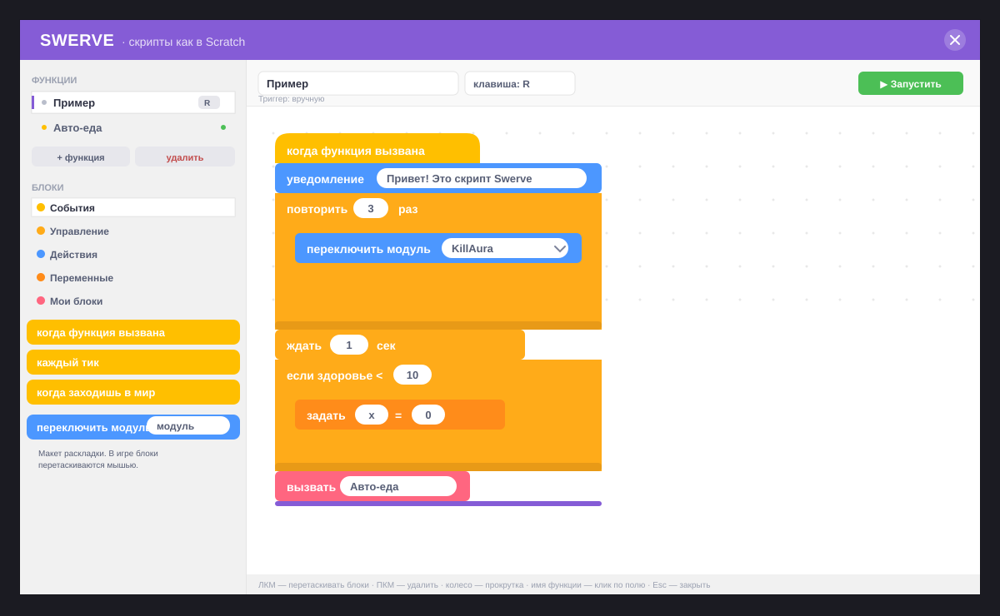

# Скрипты — окно как в Scratch

Редактор пользовательских функций-скриптов: блоки, палитра, перетаскивание мышью и
цвета Scratch 3. Функция собирается из блоков и работает прямо в клиенте — её можно
повесить на клавишу, запускать каждый тик, при входе в мир или вызывать из другой
функции.



*Макет раскладки: цвета, панели и порядок элементов совпадают с игровым окном;
шрифт в игре — фирменный MSDF-шрифт клиента.*

## Как открыть

1. Открыть ClickGUI (`Right Shift`).
2. Категория **Util** → модуль **Scripts** → включить.

Включение модуля открывает окно редактора, закрытие окна (Esc или крестик) выключает
модуль обратно. Бинд модуля можно поставить как обычно — тогда редактор открывается
с клавиши.

При первом запуске создаётся функция-пример «Пример»: она показывает уведомления с
задержкой. Её можно запустить кнопкой **▶ Запустить** и потрогать блоки.

## Окно

```
┌──────────────────────────────────────────────────────────────┐
│ SWERVE · скрипты как в Scratch                          ✕    │
├────────────────────┬─────────────────────────────────────────┤
│ ФУНКЦИИ            │ [имя функции]  [клавиша: R]  [▶ Запустить]│
│ • Пример        R  │ Триггер: вручную                        │
│ + функция  удалить ├─────────────────────────────────────────┤
│ БЛОКИ              │ ········································│
│ ● События          │     когда функция вызвана               │
│ ● Управление       │     уведомление Привет!                 │
│ ● Действия         │     ждать 1 сек                        │
│ ● Переменные       │     уведомление …                       │
│ ● Мои блоки        │ ········································│
│ [блоки категории]  │ ЛКМ — перетаскивать · ПКМ — удалить …   │
└────────────────────┴─────────────────────────────────────────┘
```

* **Палитра** — блоки выбранной категории. Клик по блоку добавляет его в конец
  скрипта, перетаскивание позволяет сразу поставить блок в нужное место.
* **Полотно** — стек выбранной функции. Блоки можно менять местами, класть внутрь
  циклов и условий. Фиолетовая полоса показывает, куда встанет блок.
* **ПКМ по блоку** — удалить блок вместе со всем, что под ним. Перетаскивание блока
  на палитру делает то же самое, как в Scratch.
* **Колесо** — прокрутка полотна, списка функций и палитры.
* **Поля блока** — клик по белому «пилюльному» полю. Числа и текст вводятся с
  клавиатуры (Enter — сохранить, Esc — отмена), а списки (модули, настройки, звуки,
  функции) открываются выпадающим меню.
* **Клавиша функции** — нажми на чип «клавиша» и затем любую клавишу или кнопку мыши;
  Backspace/Esc — сбросить.

## Блоки

### События (жёлтые, шляпы)

| Блок | Когда срабатывает |
| --- | --- |
| когда функция вызвана | вручную: кнопка, бинд или блок «вызвать» |
| каждый тик | каждый клиентский тик (20 раз в секунду) |
| когда заходишь в мир | один раз при входе в мир / смене измерения |

Триггер определяется **первым** блоком стека. Если шляпы нет, функция считается
ручной. Шляпу нельзя утащить в середину — редактор вернёт её наверх.

### Управление (оранжевое)

| Блок | Что делает |
| --- | --- |
| ждать `N` сек | приостанавливает функцию, не блокируя игру |
| повторить `N` раз | цикл с телом внутри |
| повторять всегда | бесконечный цикл (тело выполняется в рамках бюджета тика) |
| остановить скрипт | завершает функцию |
| если модуль `M` включён | условие |
| если модуль `M` выключен | условие |
| если здоровье < `N` | условие по игроку |
| если голод < `N` | условие по игроку |
| если клавиша `K` зажата | условие, поддерживает кнопки мыши |
| если `переменная` `оп` `значение` | сравнение: `= ≠ < ≤ > ≥` |
| если мир загружен | условие |
| если шанс `N` % | случайное условие |

### Действия клиента (синие)

| Блок | Что делает |
| --- | --- |
| переключить модуль `M` | `Module.toggle()` — с уведомлением, как из меню |
| включить модуль `M` / выключить | принудительное состояние |
| настройка `M` `S` = `значение` | запись настройки: число, режим, флаг, текст, бинд |
| уведомление `текст` | уведомление клиента |
| сообщение в чат `текст` | строка в чат (только для себя) |
| команда `текст` | отправка команды на сервер (`/spawn` — можно без слэша) |
| звук `файл` | встроенные звуки интерфейса Swerve |

### Переменные (оранжевые)

| Блок | Что делает |
| --- | --- |
| задать `имя` = `значение` | сохраняет значение |
| изменить `имя` на `N` | прибавляет число к переменной |

Переменные общие для всех функций и лежат в файле рядом со скриптами.

### Мои блоки (розовые)

| Блок | Что делает |
| --- | --- |
| вызвать `функция` | запускает другую функцию проекта |

Вызов выполняется сразу, но отдельным экземпляром: функция, которая уже работает, не
запускается второй раз, а глубина вложенных вызовов ограничена 8.

## Подстановки в тексте

В любом текстовом поле работает `{имя}`:

| Подстановка | Значение |
| --- | --- |
| `{player}` | ник игрока |
| `{health}`, `{food}` | здоровье и голод |
| `{x}`, `{y}`, `{z}` | координаты |
| `{fps}` | FPS клиента |
| `{world}` | текущее измерение |
| `{любаяПеременная}` | значение переменной скрипта |

Числовые поля принимают те же подстановки: `ждать {health}` или `если {x} > 100`.
Неизвестное имя остаётся в тексте как есть — опечатку видно сразу.

## Исполнение

* Бюджет — **400 блоков за тик** на функцию. Бесконечный цикл без `ждать` не
  подвешивает игру: он просто продолжается следующим тиком.
* `ждать` откладывает продолжение и не занимает поток игры.
* Ошибка в блоке завершает этот запуск, пишется в лог и показывается уведомлением —
  остальные функции продолжают работать.
* Пока открыт любой экран, бинды функций не срабатывают: набор текста в редакторе не
  запускает скрипты. Триггеры «каждый тик» и «заход в мир» работают всегда.

## Файл

`config/swerve/scripts.json`

```json
{
  "format": 1,
  "client": "Swerve",
  "variables": { "counter": "3" },
  "functions": [
    {
      "name": "Пример",
      "key": 82,
      "stack": {
        "type": "trigger_manual",
        "values": [],
        "next": {
          "type": "notify",
          "values": ["Привет! Это скрипт Swerve"],
          "next": { "type": "wait", "values": ["1"] }
        }
      }
    }
  ]
}
```

Запись атомарная (`.tmp` + перенос), как у основного конфига: падение игры во время
сохранения не оставит половину JSON. Битый файл не мешает запуску — клиент стартует
с пустым проектом и пишет предупреждение в лог.

## Как устроено

| Класс | Роль |
| --- | --- |
| `swerve.script.BlockType` | каталог блоков: подпись, поля, форма, категория |
| `swerve.script.ScriptBlock` | блок со значениями, `next` и `inner`; сам реализует `BlockHolder` — «пасть» C-блока это и есть его `inner`, поэтому вставка и перетаскивание не различают корень функции и вложенный стек |
| `swerve.script.ScriptFunction` | функция: имя, бинд, стек, триггер по шляпе |
| `swerve.script.ScriptBlocks` | поиск, открепление и вставка стеков |
| `swerve.script.ScriptStore` | JSON-хранилище функций и переменных |
| `swerve.script.ScriptEngine` | интерпретатор: кадры, циклы, ожидание, бинды |
| `swerve.script.ScriptActions` | мосты в клиент: модули, настройки, чат, команды |
| `swerve.script.ScriptText` | подстановки и разбор чисел |
| `swerve.ui.script.ScriptCanvas` | раскладка и отрисовка блоков в стиле Scratch |
| `swerve.ui.script.ScriptScreen` | окно: палитра, функции, ввод, перетаскивание |

Блоки не хранят координат: стек всегда рисуется сверху вниз, а перетаскивание — это
перестановка ссылок. Поэтому блоки не могут наехать друг на друга или «потеряться»
за краем полотна.

## Проверки

```bash
python3 Swerve/tests/check_mc_api.py     # символы Minecraft 1.21.4 по реальному jar
python3 Swerve/tests/check_scope.py     # «имя используется, но не объявлено»
python3 Swerve/tests/check_types.py     # приводимость типов (аргументы, instanceof, return)
```

`check_types.py` — статическая замена части `javac` без JDK: разрешает простые типы
локальных переменных и полей внутри `swerve.*` и проверяет аргументы вызовов,
`instanceof`, присваивания и `return`. Именно он ловит ошибку вида «класс забыл
реализовать интерфейс, в параметр которого его передают» — компилятор пишет про неё
`incompatible types`, а синтаксический разбор её не видит. Типы JDK/Minecraft и
генерики намеренно не проверяются, чтобы не было ложных находок.

Полноценная сборка по-прежнему `./gradlew build` (или `./gradlew runClient`).
