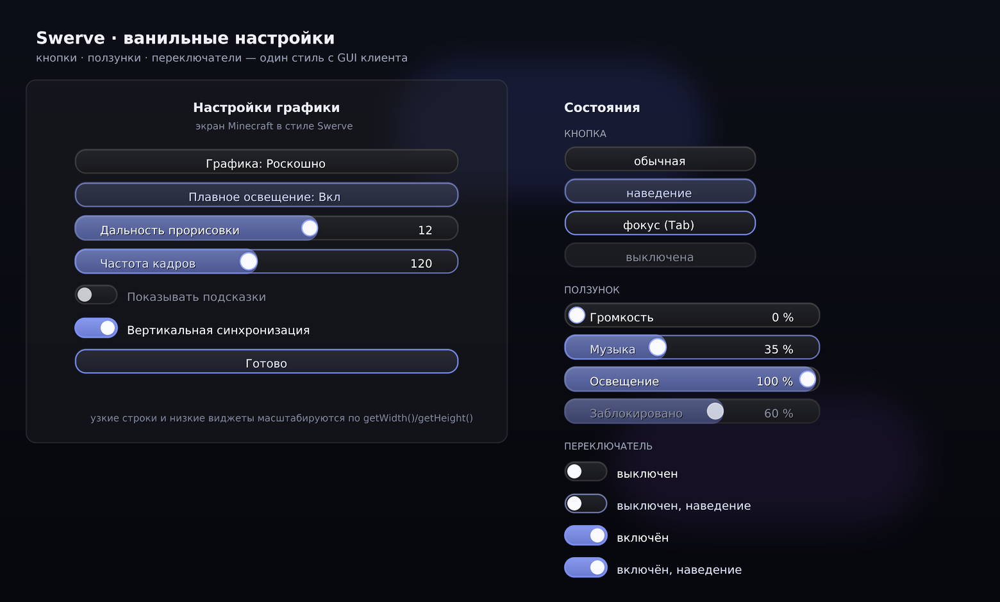

# Виджеты ванильных настроек в стиле Swerve

Экраны настроек Minecraft (`Настройки графики`, `Звук`, `Управление`, `Настройки мира`,
`Создание мира`, …) больше не рисуют ванильные спрайты: кнопки, ползунки и флажки
собираются из скруглений клиента и берут акцент из текущей темы.

## Что перерисовано

| Ванильный виджет | Было | Стало |
| --- | --- | --- |
| `Button`, `CycleButton` (кнопки, переключатели значений) | спрайт `widgets/button*` | плитка с вертикальным градиентом, акцентная вуаль и свечение при наведении, обводка акцентом при фокусе |
| `AbstractSliderButton` (ползунки громкости, дальности, FPS, …) | спрайт `widgets/slider*` + бегунок-спрайт | капсульная дорожка, полупрозрачная акцентная заливка прогресса, круглый бегунок с подсветкой; подпись `Имя: значение` разнесена по краям, чтобы бегунок не закрывал текст |
| `Checkbox` (флажки в настройках, создании мира, правилах) | квадрат 9×9 + галочка | капсульный переключатель со скользящей головкой; положение головки анимируется отдельно от наведения |

## Как это сделано

Отрисовка вынесена в `swerve/ui/newgui/VanillaWidgets.java` — там нет состояния и ссылок
на конкретные экраны, только геометрия по фактическим `getWidth()/getHeight()` виджета.
Поверх неё три миксина в `swerve/mixins/client/`:

* `MixinAbstractButton` — `@Inject` в `renderWidget` с `cancellable = true`;
* `MixinAbstractSliderButton` — то же для ползунков;
* `MixinCheckbox` — то же для флажков.

Ванильный `renderWidget` у всех трёх объявлен в родителе и не переопределяется наследниками,
которые нам нужны:

* все ползунки настроек в 1.21.4 — это `OptionInstance$OptionInstanceSliderButton`
  (наследник `AbstractSliderButton`), своего `renderWidget` он не объявляет, поэтому
  перехвата в родителе достаточно;
* кнопки и `CycleButton` наследуют `renderWidget` от `AbstractButton`;
* `Checkbox` объявляет свой `renderWidget` — он и перехватывается.

Поэтому **поведение не меняется**: перетаскивание, `applyValue()`, задержка применения
(`delayedApplyAt`), обработка нажатий, фокус по `Tab`, звуки — всё остаётся ванильным.
Подменяется только кадр отрисовки.

Перед отрисовкой вызывается `GuiGraphics.flush()`: скругления рисуются своими шейдерами
сразу, а текст `GuiGraphics` копит в буфере — без синхронизации плитка легла бы поверх
уже нарисованного текста этого же экрана.

## Палитра и настройка

Виджеты читают те же значения, что и остальной GUI клиента:

* акцент — `GuiTheme.clientColor()` (тема из `ThemeManager`, переключается в меню клиента);
* тон плитки — тон/насыщенность/яркость фона из категории **Client** (`GuiStyle`),
  поэтому при смене темы настроек меняются и ванильные экраны;
* анимации наведения сглаживаются по реальному времени кадра
  (`1 - e^(-18·dt)`), а не по номеру кадра, — скорость одинакова при любом FPS.

## Что осталось ванильным

Виджеты, которые рисуют собственные спрайты своим `renderWidget`, не тронуты — иначе плитка
перекрыла бы иконку: `ImageButton`, `LockIconButton`, `PageButton`, `PlainTextButton`
и `SpriteIconButton` (выбор наборов ресурсов и миров; для него в `MixinAbstractButton`
есть явная проверка типа).

Текстовые поля, списки и заголовки экранов остаются ванильными.

## Проверка

* `python3 Swerve/tests/check_mc_api.py` — импорты, цели миксинов, сигнатуры callback'ов,
  `@At`-таргеты и наличие каждого миксина в `swerve.mixins.json`;
* `python3 Swerve/tests/check_scope.py Swerve/src/main/java` — области видимости;
* `python3 Swerve/tests/check_config.py` — конфиг не затронут.

Как и для остальных правок в этом окружении, `./gradlew compileJava` не запускался (нет JDK),
поэтому статические проверки не заменяют сборку и запуск игры.
